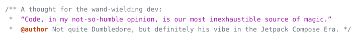
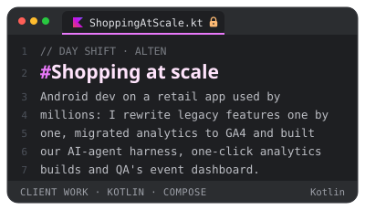
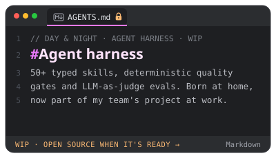
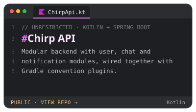

<!--
  🪄 You're reading the source. Respect.
  Recruiter or fellow dev? Put "Alohomora" in the subject of your message
  and I'll know you came in through the secret door.
-->

  <picture>
    <source media="(prefers-color-scheme: dark)" srcset="assets/banner-dark.svg">
    
  </picture>

<h3><picture><source media="(prefers-color-scheme: dark)" srcset="assets/h-hello-dark.svg"></picture></h3>

<!-- The <a name> without href keeps GitHub from wrapping the image in a link, so a click opens the Howler. -->

 

<!--
  🎙️ Voice: once recorded, drag the .mp4 into GitHub's web editor and paste the
  user-attachments URL here, on its own line, so the player shows above the letter.
-->

<h3><picture><source media="(prefers-color-scheme: dark)" srcset="assets/h-shifts-dark.svg"></picture></h3>

  
  
  
  

<h3><picture><source media="(prefers-color-scheme: dark)" srcset="assets/h-unrestricted-dark.svg"></picture></h3>

  
  

<h3><picture><source media="(prefers-color-scheme: dark)" srcset="assets/h-house-rules-dark.svg"></picture></h3>

<h3><picture><source media="(prefers-color-scheme: dark)" srcset="assets/h-wand-cores-dark.svg"></picture></h3>

  
  
  

